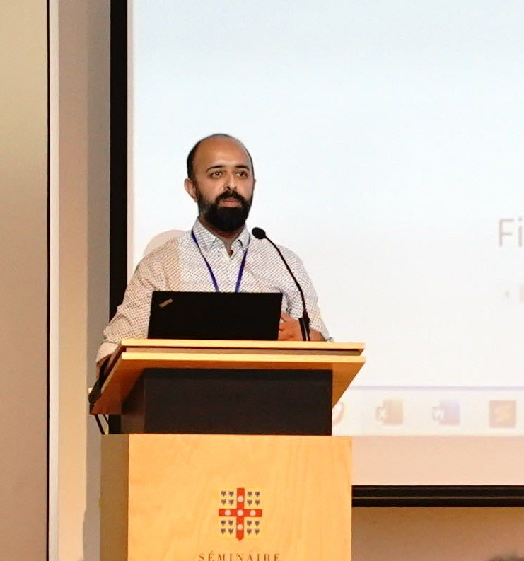

```{=html}
<section class="home-hero" aria-labelledby="home-title">
<div class="home-hero-main">
<p class="home-kicker">Mobility data science</p>
<h1 id="home-title">Researching movement, space, and health.</h1>
<p class="home-intro">I am a Research Fellow in Mobility Data Science in the School of Geography at the University of Leeds. My current research explores the mobility of healthcare workers and its impact on infection transmission within healthcare settings.</p>
<div class="home-actions" aria-label="Professional links">
<a class="home-action-primary" href="publications.html">Publications</a>
<a href="cv.html">Curriculum vitae</a>
<a href="https://environment.leeds.ac.uk/geography-research-institute-spatial-data-science/staff/10166/keiran-suchak">Contact via University profile</a>
</div>
</div>
<aside class="home-profile">

<p>School of Geography<br>University of Leeds</p>
</aside>
</section>

<section class="home-work-band" aria-labelledby="home-work-title">
<div class="home-work">
<div class="home-work-heading">
<h2 id="home-work-title">Selected work</h2>
<p>From identifying co-location to updating real-time crowd models.</p>
</div>
<div class="home-work-list">
<article class="home-work-item">
<p class="home-work-year"><time datetime="2024">2024</time></p>
<h3>Towards a general framework for co-location</h3>
<p>Explores how definitions and uncertain observations affect whether we can identify when people were in the same place.</p>
<div class="home-work-links">
<a href="papers/24_cosit/index.html">Read summary</a>
<a href="https://doi.org/10.4230/LIPIcs.COSIT.2024.24">Published paper</a>
</div>
</article>
<article class="home-work-item">
<p class="home-work-year"><time datetime="2024">2024</time></p>
<h3>Coupling an agent-based model and an ensemble Kalman filter for real-time crowd modelling</h3>
<p>Combines a crowd simulation with incoming observations to keep its model closer to what is happening in real time.</p>
<div class="home-work-links">
<a href="papers/24_rsos/index.html">Read summary</a>
<a href="https://doi.org/10.1098/rsos.231553">Published paper</a>
</div>
</article>
</div>
</div>
</section>

<section class="home-networks" aria-labelledby="networks-title">
<h2 id="networks-title">Working across spatial data science and mobility research.</h2>
<p>I am a member of the <a href="https://environment.leeds.ac.uk/geography-research-institute-spatial-data-science/">Institute for Spatial Data Science</a> and the <a href="https://mobscilab.com/">Mobility Science Lab</a>.</p>
<div class="home-actions" aria-label="Research profiles">
<a href="https://mobscilab.com/people/keiran-suchak/">MOB.SCI.LAB profile</a>
<a href="https://scholar.google.com/citations?user=RUJDDR4AAAAJ">Google Scholar</a>
<a href="https://github.com/ksuchak1990">GitHub</a>
</div>
</section>
```
